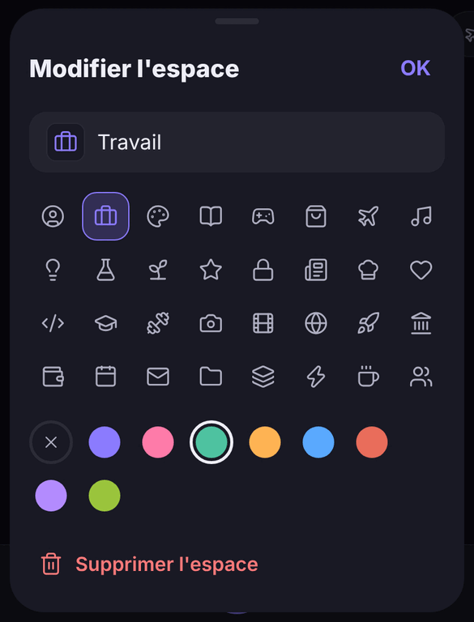

# Browser — version mobile (iOS et Android)

Le navigateur Browser, pensé pour le téléphone : tout se fait au pouce, en bas de l'écran.
Application [Expo](https://expo.dev) / React Native (SDK 58, React Native 0.88), qui réutilise
directement le code de la version de bureau (`../src/shared` : URL et moteurs de recherche,
historique et suggestions, recherche floue, palette de commandes, paramètres, moteur de thème,
espaces, mode HTTPS uniquement).

| Accueil | Onglets et espaces | Espace | Recherche |
| --- | --- | --- | --- |
|  |  |  |  |

(Captures faites avec le rendu web de développement : la page affichée est un faux contenu.)

## L'essayer sur votre téléphone depuis Windows (Expo Go)

Rien à compiler : l'application tourne dans **Expo Go**, l'appli gratuite d'Expo.

1. **Sur le téléphone**, installez **Expo Go** depuis l'App Store (iPhone) ou le Play Store (Android).
   Il faut la version d'Expo Go qui prend en charge le **SDK 58** (la version actuelle des stores).
2. **Sur le PC Windows**, installez [Node.js](https://nodejs.org) 20 ou plus récent (version LTS),
   puis ouvrez **PowerShell** (ou le terminal de VS Code) dans le dossier du projet :

   ```powershell
   cd mobile
   npm install
   npx expo start
   ```

3. Un **QR code** s'affiche dans le terminal.
   - **iPhone** : ouvrez l'appareil photo et visez le QR code, puis touchez la bannière « Ouvrir dans Expo Go ».
   - **Android** : ouvrez Expo Go et touchez « Scan QR code ».
4. Le téléphone et le PC doivent être **sur le même réseau Wi-Fi**. Sinon (Wi-Fi d'entreprise,
   VPN, partage de connexion…), lancez plutôt :

   ```powershell
   npx expo start --tunnel
   ```

   (la première fois, Expo propose d'installer `@expo/ngrok` : acceptez.)

Chaque modification du code est rechargée instantanément sur le téléphone. Secouez le téléphone
(ou touchez le bouton flottant d'Expo Go) pour ouvrir le menu de développement et recharger.

### En cas de problème

- **Le QR code ne marche pas / « Could not connect to the server »** : vérifiez que le PC et le
  téléphone sont sur le même Wi-Fi, puis essayez `npx expo start --tunnel`.
- **Le pare-feu Windows** demande l'autorisation pour Node.js : acceptez pour les réseaux **privés**.
  Si vous avez refusé : Panneau de configuration → Pare-feu Windows Defender → « Autoriser une
  application » → cochez Node.js.
- **« Project is incompatible with this version of Expo Go »** : mettez à jour Expo Go depuis le store
  (l'application utilise le SDK 58).
- **Écran rouge après une mise à jour du code** : `npx expo start --clear` vide le cache de Metro.
- **`npm install` échoue** : supprimez `mobile\node_modules` et relancez `npm install`.
- **Le PC a plusieurs cartes réseau** (VirtualBox, WSL, VPN) et le téléphone n'atteint pas la bonne
  adresse : `--tunnel` règle le problème.

## Synchronisation avec le PC

Paramètres → **Synchronisation** → « Scanner le code de jumelage » (le QR code s'affiche sur le PC dans
Paramètres → Synchronisation). Chiffrement de bout en bout, serveur auto-hébergé : voir
[`../server/README.md`](../server/README.md) et l'ADR-019. Les onglets du PC apparaissent dans la vue
des onglets (« Autres appareils ») et dans la recherche. Rien de la navigation privée n'est envoyé.

## Ce que l'on peut faire

- **Barre d'adresse en bas**, dans la zone du pouce. Elle se réduit à un simple nom de domaine
  quand on fait défiler la page vers le bas et revient quand on remonte (ou d'un toucher).
- **Balayer la barre d'adresse** vers la gauche ou la droite pour passer à l'onglet suivant ou
  précédent ; après le dernier onglet, un nouvel onglet s'ouvre. **La balayer vers le haut** (ou
  toucher le bouton des onglets) ouvre la vue des onglets, avec une transition « zoom ».
- **Recherche plein écran** : le champ est juste au-dessus du clavier ; suggestions issues de
  l'historique et des favoris (classées par fréquence et récence), onglets ouverts (recherche
  floue), actions rapides (épingler, dupliquer, copier le lien, favoris, partager, onglet privé…).
- **Vue des onglets** : grille de cartes (balayer une carte sur le côté pour la fermer, la
  maintenir pour l'épingler, la dupliquer, la déplacer vers un autre espace), onglets épinglés en
  haut, **espaces** sous forme de pastilles (maintenir une pastille pour la renommer, changer son
  icône et sa couleur, ou la supprimer), bouton « + ».
- **Navigation privée** : pastille « Privé » de la vue des onglets, ou « Nouvel onglet privé ».
  Rien n'est enregistré (ni historique ni session). Sur iPhone, chaque onglet privé a ses propres
  cookies, effacés à sa fermeture. Sur Android, voir les limites ci-dessous.
- **Maintenir un lien** : ouvrir dans un nouvel onglet, en arrière-plan, en privé, copier ou partager.
- **Gestes** : bord de l'écran pour revenir en arrière (iPhone), bouton/geste retour du système
  (Android), tirer la page vers le bas pour l'actualiser (iPhone), retours haptiques.
- **Page d'accueil** : salutation, heure, favoris et sites les plus visités.
- **Paramètres** : moteur de recherche, thème clair/sombre/automatique et couleur d'accent (palette
  calculée avec contrastes garantis, comme sur le bureau), page d'accueil, comportement des
  onglets, effacement de l'historique et des données, gestion des favoris.
- **Sécurité** : mode HTTPS uniquement, seuls `http(s)`, `about:` et `data:` sont autorisés,
  `mailto:`/`tel:`/`sms:` ouvrent l'application du système, pas d'accès aux fichiers, pas de
  contenu mixte, pas de fenêtres surgissantes automatiques (les liens « nouvelle fenêtre » ouvrent
  un onglet). Voir l'ADR-016 dans `docs/DECISIONS.md`.

## Limites de la phase 1 (Expo Go)

- **Pas encore de bloqueur de pubs et traqueurs** : il faut du code natif (règles de contenu
  WebKit sur iOS, interception des requêtes sur Android), donc une version compilée de l'application
  (« development build »). C'est prévu en phase 2 (voir `docs/ROADMAP.md`).
- **Android, onglets privés** : l'option « incognito » de la WebView Android effacerait les cookies
  de *tous* les onglets ; elle n'est donc pas utilisée. Les onglets privés n'ont ni historique, ni
  cache, ni formulaires mémorisés, mais partagent encore les cookies des autres onglets.
- **Pas de miniatures de pages** dans la vue des onglets (il faudrait `react-native-view-shot`,
  absent d'Expo Go) : chaque carte, neutre, affiche le favicon du site (ou son initiale).
- **Tirer pour actualiser** n'existe que sur iPhone (la WebView Android ne le propose pas) ;
  sur Android, utilisez le bouton Recharger de la barre d'adresse.
- Les cookies des sites ne peuvent pas être effacés depuis l'application dans Expo Go.

## Développement

| Commande (dans `mobile/`) | Rôle |
| --- | --- |
| `npx expo start` | Serveur de développement (QR code pour Expo Go) |
| `npm run typecheck` | TypeScript strict |
| `npm test` | Tests unitaires (Jest, preset `jest-expo`) |
| `npm run export:android` / `export:ios` | Bundle de production (vérifie toutes les importations) |
| `npx expo start --web` | Aperçu de l'interface dans un navigateur (la page web y est simulée) |

Structure :

```
mobile/
  index.ts                point d'entrée Expo
  metro.config.js         résolution de `@shared/*` vers ../src/shared (sans copie)
  src/
    App.tsx               fournisseurs (gestes, zones sûres, clavier, état, thème)
    state/                état du navigateur (onglets, historique, favoris, paramètres) et thème
    lib/                  logique pure et testée : onglets/espaces, navigation, gestes, recherche…
    components/           écrans : barre du bas, onglet WebView, recherche, vue des onglets…
```

Le code partagé avec le bureau s'importe avec `@shared/…` (ex. `import { normalizeInput } from "@shared/url"`) :
ne jamais le recopier dans `mobile/`. Les modules de `src/shared` doivent rester purs
(ni Electron, ni Node, ni DOM).
