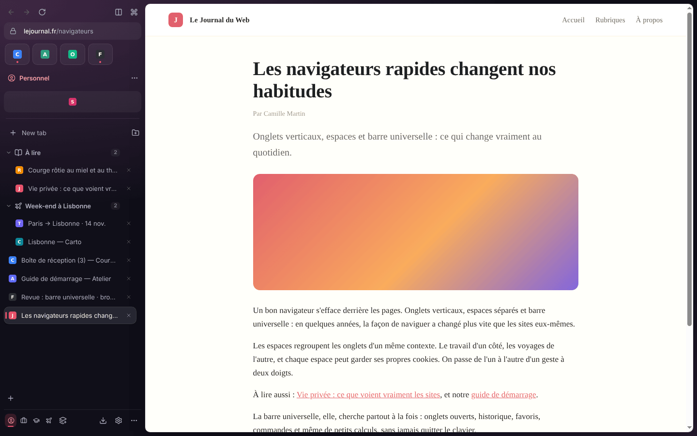
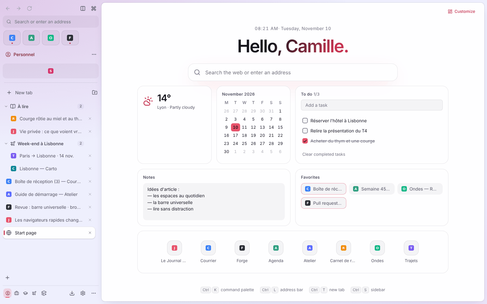
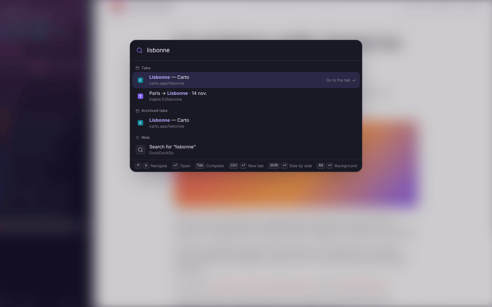
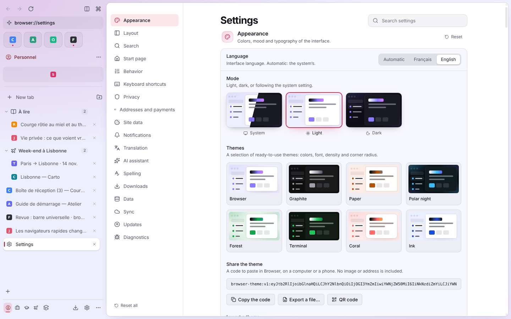

# Browser

[](https://github.com/Mathieu-Lalande/browser/actions/workflows/ci.yml)
[](https://github.com/Mathieu-Lalande/browser/releases)
[](LICENSE)

A **fast, private and fully customizable** browser in the spirit of Arc and Zen, for Windows, macOS and
Linux, with its iPhone and Android app. The interface is available in English and French.

*Version française : [`readme.md`](readme.md) (the reference; the project's docs are written in French).*

- **Website and downloads**: https://mathieu-lalande.github.io/browser/en/
- **User guide**: https://mathieu-lalande.github.io/browser/en/docs.html
- **Install, develop, release**: [`docs/INSTALL.md`](docs/INSTALL.md) · **Decisions**:
  [`docs/DECISIONS.md`](docs/DECISIONS.md) (ADR-001 to 052) · **Roadmap**: [`docs/ROADMAP.md`](docs/ROADMAP.md)
- **Project**: [`CONTRIBUTING.md`](CONTRIBUTING.md) · [`SECURITY.md`](SECURITY.md) ·
  [`CHANGELOG.md`](CHANGELOG.md) · [`LICENSE`](LICENSE)

## Highlights

**Organize**: vertical sidebar, spaces with their own icon, color and optional isolated cookies, two-finger
swipe between spaces, nested tab folders, a shared favorites grid, automatic archiving, split view (2 to 4
pages), tab sleeping, tab previews on hover, dynamic theme, a fold-away window bar with the sidebar mode
(full, compact rail, zen) and a single "…" menu.

**Find and act**: universal bar (`Ctrl+K`) over tabs, bookmarks, history, commands, settings and other devices'
tabs, with instant answers; link peek; reader mode; page translation (DeepL, LibreTranslate or Google, off by
default); notes and highlights; page options, screenshots and tab video; web panels beside the page (WhatsApp
Web, Spotify…); "Read later" with offline text; optional AI assistant with your own Anthropic key.

**Make it yours**: live settings, 8-theme gallery and shareable themes, per-site boosts (filters, fonts, hidden
elements, CSS), customizable shortcuts, Chrome extensions (unpacked, `.zip`, `.crx`) and one-click installs from
the Chrome Web Store ("Ajouter à Browser" / "Add to Browser"), a widget-based new tab page, English or French UI.

**Protect**: private search by default, strict security model (pages never get a preload or Node), ad and
tracker blocker, HTTPS-only, automatic cookie-banner refusal, privacy dashboard, secure DNS, fingerprinting
protection, per-site settings, private windows, password manager, addresses and cards, passkeys, crash
recovery, profiles and backups, end-to-end encrypted sync with your phone through a small self-hosted server.

**Desktop integration**: default browser, built-in PDF viewer, history, import from Chrome, Edge, Brave, Vivaldi,
Opera, Firefox and Arc, a mini window for links from other apps, energy saver, Windows Jump List, taskbar
progress and Mica, Widevine (castLabs Electron) for protected content.

**Phone** (`mobile/`, Expo / React Native): one-handed bottom bar, tab overview with spaces, private tabs,
sync, reader, passwords, translation, notes, reading list, assistant, and a native ad blocker in the compiled
app.

| | |
| --- | --- |
|  |  |
|  |  |

More screenshots (light and dark, French UI) are in [`docs/screenshots/`](docs/screenshots/) and in the French
readme.

## Install

Download the latest version from **https://mathieu-lalande.github.io/browser/en/** (the button detects your
system) or from the [GitHub releases](https://github.com/Mathieu-Lalande/browser/releases): Windows installer
(x64 and ARM, no admin rights), portable `.zip`, macOS `.dmg` (Apple Silicon and Intel), AppImage and `.deb`
for Linux, with `SHA256SUMS.txt`. The app updates itself from the releases (stable or beta channel).

## Develop

Node.js 22, then:

```bash
npm install        # also fetches the castLabs Electron binary (scripts/ensure-electron.mjs)
npm run dev        # starts the browser with hot reload of the UI
```

Checks (as in CI): `npm run typecheck && npm run check:cycles && npm run check:i18n && npm test && npm run build`
then `xvfb-run -a npx playwright test` on Linux. Phone: `cd mobile && npm install && npx expo start` (Expo Go).
Everything else (packaging, signing, releases, stores, sync server) is in [`docs/INSTALL.md`](docs/INSTALL.md).

UI text lives in two catalogs, `src/shared/i18n/fr.ts` (source) and `en.ts`; a missing English key fails the
typecheck (ADR-052).

## License

Proprietary software, all rights reserved (see [`LICENSE`](LICENSE); `package.json` declares it
`UNLICENSED`). To contribute, see [`CONTRIBUTING.md`](CONTRIBUTING.md). Third-party dependencies keep their own
licenses.
