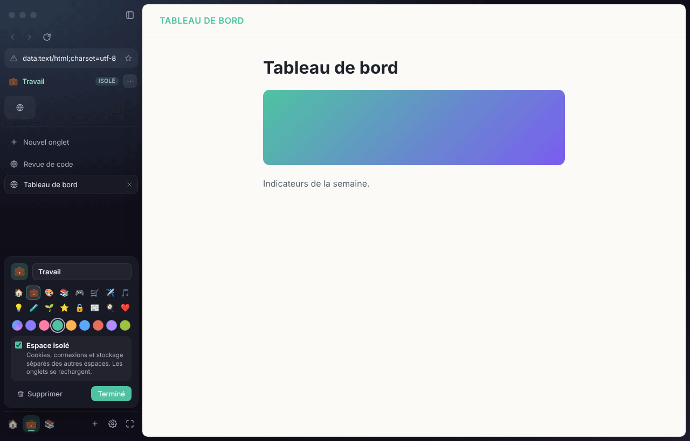
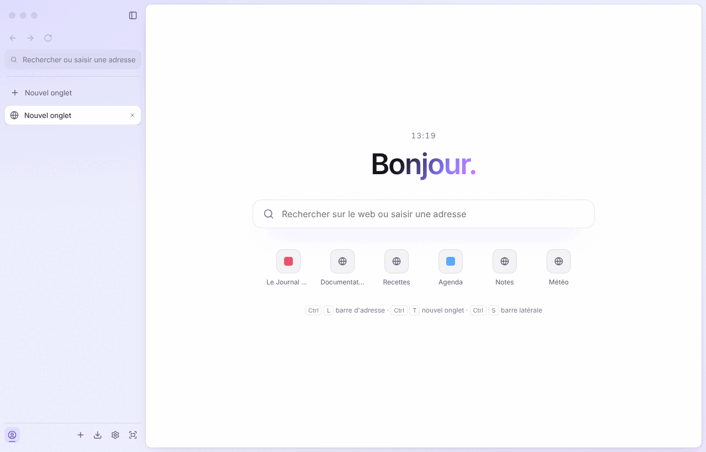

# Browser

Un navigateur desktop **rapide, privé et entièrement personnalisable**, dans l'esprit d'Arc et de Zen.

- Moteur Chromium via Electron, un onglet = une `WebContentsView` sandboxée.
- Interface Svelte 5 : barre latérale verticale, onglets épinglés, barre d'adresse intégrée, page d'accueil.
- Espaces (onglets, icône et couleur propres ; sessions isolées façon conteneurs en option) et vue scindée
  (2 à 4 pages côte à côte).
- Session restaurée au démarrage (onglets chargés à la demande), historique, favoris, suggestions
  dans la barre d'adresse et sites les plus visités sur la page d'accueil.
- Palette de commandes (`Ctrl+K`, `⌘K` sous macOS) : onglets ouverts, favoris, historique et actions, recherche floue.
- Recherche privée par défaut (DuckDuckGo), protections de sécurité strictes (voir `docs/DECISIONS.md`).
- Boucliers intégrés : bloqueur de pubs & traqueurs (listes EasyList/uBlock via Ghostery), mode HTTPS uniquement,
  Global Privacy Control, invite de permissions par site, user agent et client hints sans trace d'Electron,
  `Accept-Language` uniformisable.
- Fenêtres privées (`Ctrl+Maj+N`, `⇧⌘N`) : session en mémoire propre à la fenêtre, effacée à sa fermeture ;
  ni historique, ni session, ni autorisations mémorisées.
- Mise en veille des onglets inactifs (mémoire libérée, page rechargée au retour ; jamais pour un onglet
  qui joue du son ou un formulaire en cours).
- Paramètres (`browser://settings`) appliqués à chaud : thème clair/sombre/auto, couleur d'accent avec
  palette dérivée accessible, arrière-plans, densité, coins, police, barre latérale à gauche ou à droite
  (redimensionnable), page bord à bord, mode zen, moteur de recherche, page d'accueil personnalisée.
- Téléchargements sans boîte de dialogue (pause, reprise, annulation, historique, `browser://downloads`) ;
  les programmes et scripts attendent une confirmation et rien n'est jamais ouvert automatiquement.
- Recherche dans la page, zoom mémorisé par site, image dans l'image, son coupé onglet par onglet.
- Synchronisation chiffrée de bout en bout avec le téléphone (favoris, historique récent, onglets
  ouverts, espaces, thème) via un petit serveur que vous hébergez ([`server/`](server/README.md)) et
  qui ne voit que des données illisibles ; jumelage par QR code. Jamais la navigation privée.





## Installer

Téléchargez la dernière version sur le site **https://mathieu-lalande.github.io/browser/** ou dans les
[releases GitHub](https://github.com/Mathieu-Lalande/browser/releases/latest) : installateur Windows
(x64 et ARM, sans droits administrateur), version portable `.zip`, `.dmg` macOS (Apple Silicon et Intel),
AppImage et `.deb` pour Linux, avec `SHA256SUMS.txt`. Les paquets ne sont pas encore signés (voir la FAQ du site).

**Publier une version** : `npm run release:version -- 0.3.0` puis `git push --follow-tags`. Le workflow
`.github/workflows/release.yml` construit les trois systèmes et crée la release (ou : *Actions* → *Release* →
*Run workflow*). Le site vitrine (`site/`) est déployé sur GitHub Pages par `.github/workflows/site.yml` ;
à activer une fois dans *Settings → Pages → Source : GitHub Actions*. Détails : `docs/INSTALL.md` (section 2.2)
et ADR-023.

Captures du site : [`docs/screenshots/site-desktop.png`](docs/screenshots/site-desktop.png), [`site-mobile.png`](docs/screenshots/site-mobile.png).

## Démarrer

Guide complet (développement sur PC et iPhone, installateurs, TestFlight, App Store) : [`docs/INSTALL.md`](docs/INSTALL.md).

Prérequis : Node.js 20+.

```bash
npm install
npm run dev        # lance le navigateur en mode développement (HMR sur l'interface)
```

## Version mobile (iOS et Android)

Le dossier [`mobile/`](mobile/README.md) contient l'application pour téléphone (Expo / React Native),
pensée pour une utilisation à une main : barre d'adresse en bas qui se replie au défilement,
balayage de la barre pour changer d'onglet, recherche plein écran, vue des onglets avec espaces,
navigation privée. Elle réutilise directement `src/shared` (URL, historique, recherche floue,
commandes, paramètres, thème, HTTPS uniquement) ; voir l'ADR-016.

Pour l'essayer sur votre téléphone (Windows, macOS ou Linux) : installez **Expo Go** depuis
l'App Store ou le Play Store, puis

```bash
cd mobile
npm install
npx expo start     # scannez le QR code ; même Wi-Fi, ou `npx expo start --tunnel`
```

| Accueil | Onglets | Recherche |
| --- | --- | --- |
|  |  |  |

## Scripts

| Commande | Rôle |
| --- | --- |
| `npm run dev` | Développement |
| `npm run build` | Build de production dans `out/` |
| `npm run typecheck` | TypeScript (process principal) + svelte-check (interface) |
| `npm test` | Tests unitaires (Vitest) |
| `npm run test:e2e` | Tests end-to-end (Playwright pilotant Electron) |
| `npm run dist` | Paquets installables (electron-builder) dans `release/` |
| `npm run dist:dir` | Application empaquetée non compressée (plus rapide, pour tester) |
| `npm run dist:win` | Installateur NSIS et `.zip` Windows (x64 et arm64), à lancer sous Windows |
| `npm run release:version -- <version>` | Monte la version, commit et tag `v<version>` (puis `git push --follow-tags`) |

Sous Linux sans affichage (CI) : `xvfb-run -a npm run test:e2e`. Test de fumée du paquet :
`npm run dist:dir && BROWSER_PACKAGED=release/linux-unpacked/browser xvfb-run -a npx playwright test packaging`.
La CI GitHub Actions (`.github/workflows/ci.yml`) lance les vérifications à chaque push et construit des
paquets non signés pour Linux, Windows et macOS sur `master` (ADR-015) ; un tag `v*` publie une release (ADR-023).

## Raccourcis

Une seule notation, celle de l'interface (infobulles, palette, page d'accueil), tirée du registre des
commandes (`src/shared/commands.ts`) : « Maj » pour Shift sous Windows/Linux, symboles sous macOS.

| Windows / Linux | macOS | Action |
| --- | --- | --- |
| `Ctrl+K` | `⌘K` | Palette de commandes (`Ctrl+↵` / `⌘↵` : ouvrir dans un nouvel onglet) |
| `Ctrl+L` | `⌘L` | Barre d'adresse |
| `Ctrl+T` / `Ctrl+W` | `⌘T` / `⌘W` | Nouvel onglet / fermer l'onglet |
| `Ctrl+N` / `Ctrl+Maj+N` | `⌘N` / `⇧⌘N` | Nouvelle fenêtre / nouvelle fenêtre privée |
| `Ctrl+Maj+K` | `⇧⌘K` | Dupliquer l'onglet (avec son historique) |
| `Ctrl+Maj+C` | `⇧⌘C` | Copier l'URL de la page |
| `Ctrl++` / `Ctrl+-` / `Ctrl+0` | `⌘+` / `⌘-` / `⌘0` | Zoom avant / arrière / zoom par défaut (mémorisé par site) |
| `Ctrl+F` | `⌘F` | Rechercher dans la page (`↵` / `Maj+↵`, `F3` / `Maj+F3` (`⌘G` / `⇧⌘G`) : suivante / précédente) |
| `Ctrl+Maj+J` | `⌥⌘L` | Téléchargements |
| `Ctrl+M` | `⌃M` | Couper / réactiver le son de l'onglet |
| `Ctrl+Tab` / `Ctrl+Maj+Tab` | `⌃Tab` / `⌃⇧Tab` | Onglet suivant / précédent |
| `Ctrl+1…9` | `⌘1…9` | Aller à l'onglet n |
| `Ctrl+S` | `⌘S` | Afficher/masquer la barre latérale |
| `Ctrl+Maj+B` | `⇧⌘B` | Mode zen (barre latérale masquée, page bord à bord) |
| `Ctrl+Alt+1…9`, `Ctrl+Alt+←/→` | `⌥⌘1…9`, `⌥⌘←/→` | Aller à l'espace n / espace précédent, suivant |
| `Ctrl+Maj+\` | `⇧⌘\` | Vue scindée (l'onglet actif et le suivant côte à côte) / la quitter |
| `Ctrl+,` | `⌘,` | Paramètres |
| `Ctrl+D` | `⌘D` | Ajouter/retirer la page des favoris |
| `Ctrl+R`, `F5` | `⌘R` | Actualiser |
| `Alt+←` / `Alt+→` | `⌘[` / `⌘]` | Page précédente / suivante |

Liste des onglets au clavier : un seul arrêt de tabulation, `↑`/`↓`, `Début`/`Fin` pour se déplacer,
`↵`/`Espace` pour afficher l'onglet, `Suppr`/`⌫` pour le fermer. Clic droit sur un onglet : épingler,
dupliquer, vue scindée, déplacer vers un espace, mettre en veille, fermer… Double-clic : épingler / désépingler.

## Structure

```
src/
  main/       process principal : fenêtres, onglets, sécurité, menus/raccourcis, IPC
    storage/  persistance JSON (session, historique, favoris, paramètres), logique pure et testée
  preload/    pont sécurisé exposant window.browser à l'interface
  renderer/   interface du navigateur (Svelte 5)
  shared/     logique pure partagée bureau + mobile : types, contrat IPC, URL et recherche,
              historique, HTTPS uniquement, paramètres, moteur de thème (testés)
mobile/       application iOS/Android (Expo / React Native), voir mobile/README.md
tests/e2e/    tests Playwright + Electron
docs/         décisions d'architecture et roadmap
```
