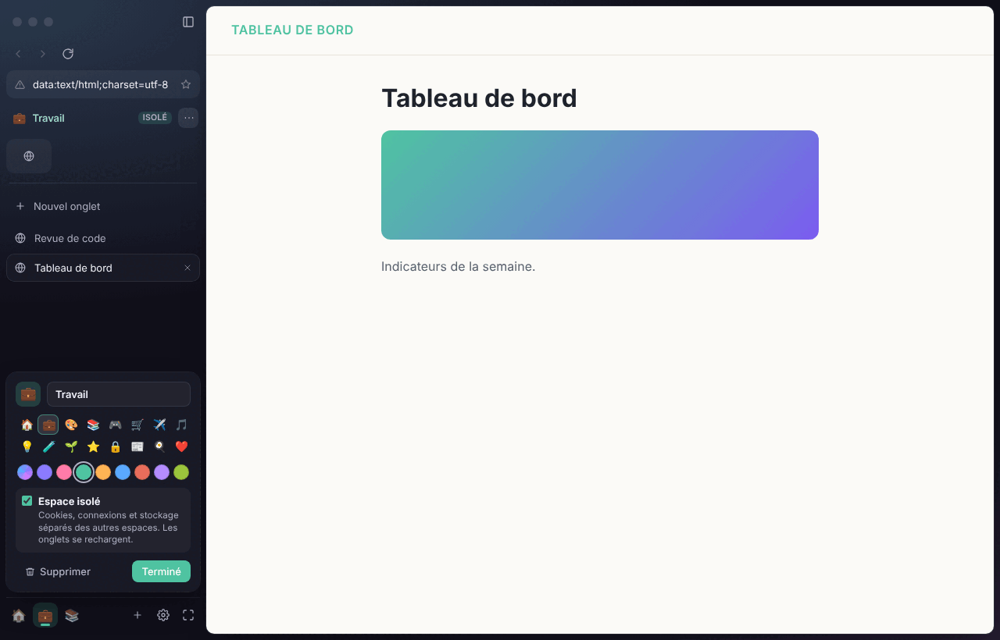
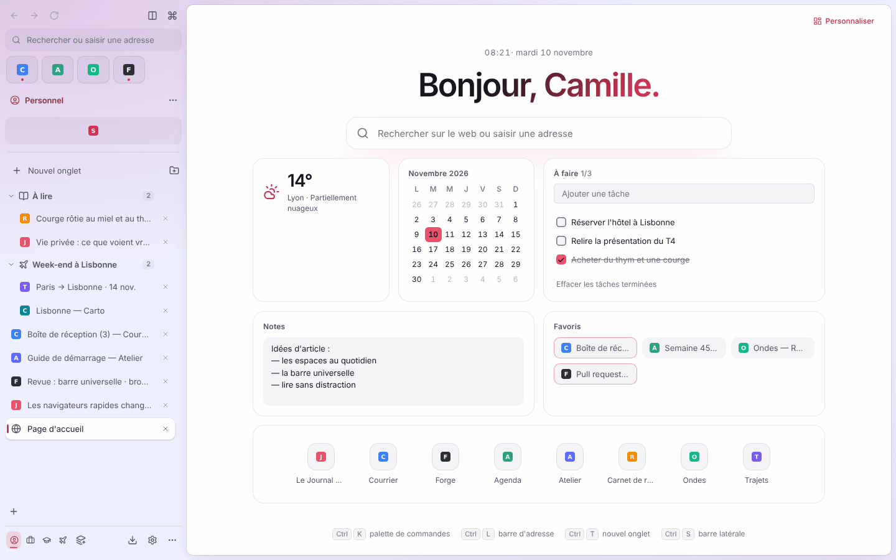
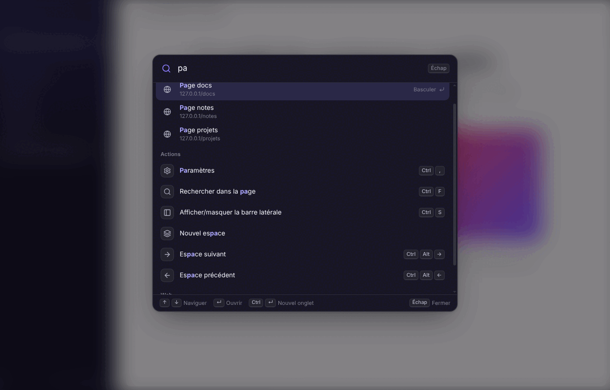
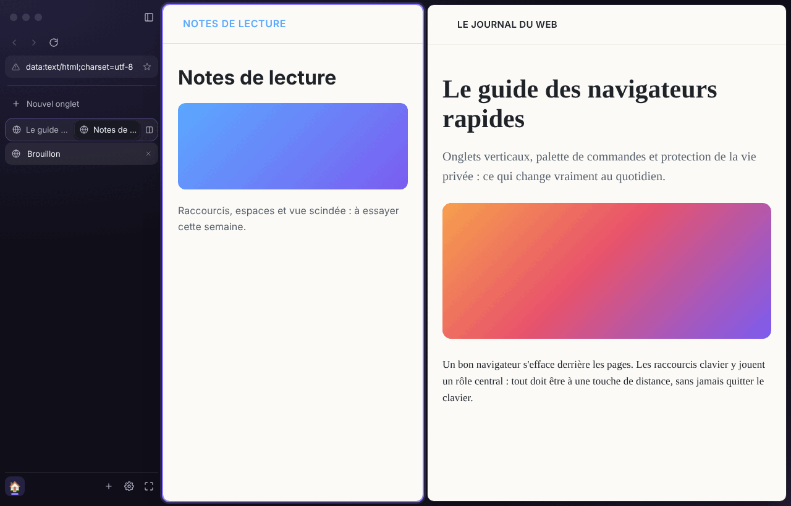
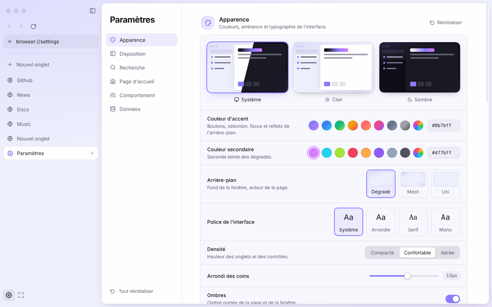
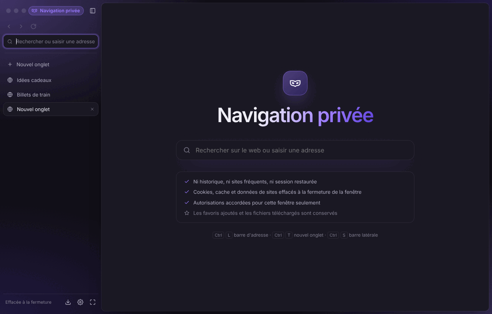
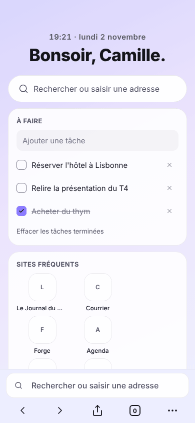
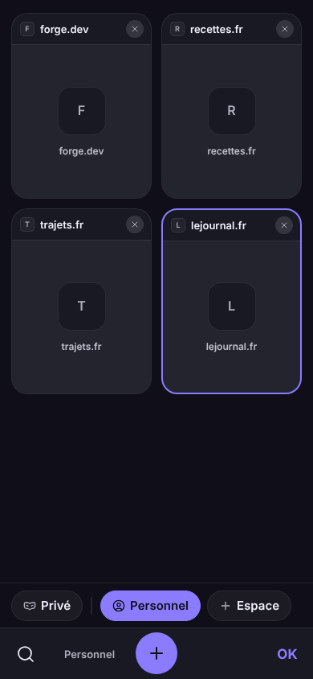
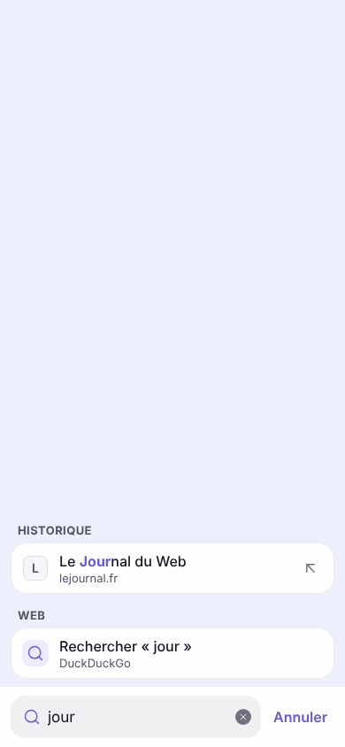

# Browser

Un navigateur **rapide, privé et entièrement personnalisable**, dans l'esprit d'Arc et de Zen, pour
Windows, macOS et Linux, avec son application iPhone et Android.

- **Site et téléchargements** : https://mathieu-lalande.github.io/browser/
- **Guide d'utilisation** : https://mathieu-lalande.github.io/browser/docs.html
- **Installer, développer, publier** : [`docs/INSTALL.md`](docs/INSTALL.md) · **Décisions** :
  [`docs/DECISIONS.md`](docs/DECISIONS.md) · **Feuille de route** : [`docs/ROADMAP.md`](docs/ROADMAP.md)

## Fonctionnalités

**Organiser**
- Barre latérale verticale, onglets épinglés, session restaurée au démarrage (onglets chargés à la demande).
- Espaces : onglets, icône Lucide et couleur propres, sessions isolées façon conteneurs en option ; balayage à
  deux doigts (pavé tactile) ou d'un doigt (écran tactile) entre espaces, `Ctrl+Alt+1…9` (ADR-009, 022, 031).
- Vue scindée : 2 à 4 pages côte à côte, séparateurs ajustables (ADR-009).
- Dossiers d'onglets imbriqués, grille des favoris commune aux espaces, archivage automatique des onglets
  inactifs (`browser://archive`) (ADR-022).
- Mise en veille des onglets inactifs (jamais pendant du son, une autorisation ou un formulaire) (ADR-014).

**Trouver et agir**
- Barre universelle (`Ctrl+K`, `⌘K`) : onglets de tous les espaces, favoris, historique, commandes, réglages,
  onglets des autres appareils et archivés ; filtres `@onglets @favoris @historique @commandes @réglages` ;
  réponses instantanées locales (calculs, conversions d'unités, heure d'une ville, bases) (ADR-032).
- Aperçu des liens (`Maj`+clic) dans une carte flottante (ADR-027) ; mode lecture (`Ctrl+Alt+R`) et version
  mobile d'un site (ADR-026).
- Options de la page (`Ctrl+Maj+O`) : zoom, captures d'écran (zone visible, page entière, élément), vidéo de
  l'onglet (`Ctrl+Alt+V`), QR code (ADR-031).
- Menu contextuel complet des pages, infos sur le site, données des sites (ADR-021).
- Téléchargements sans boîte de dialogue (pause, reprise, `browser://downloads`), recherche dans la page, zoom
  mémorisé par site, image dans l'image, son coupé par onglet (ADR-013).
- Raccourcis personnalisables, conflits signalés (ADR-028).

**Personnaliser**
- Paramètres appliqués à chaud (`browser://settings`) : thème clair/sombre/auto, couleur d'accent avec palette
  dérivée accessible, arrière-plans, densité, coins, police, barre latérale à gauche ou à droite, mode zen,
  moteur de recherche, page d'accueil (ADR-011).
- Galerie de 8 thèmes et thèmes partageables (code `browser-theme:v1:…`, fichier `.browsertheme`, QR code) (ADR-030).
- Boosts par site : filtres de couleur, police, éléments masqués, CSS, script optionnel (`browser://boosts`) (ADR-029).
- Extensions Chrome non empaquetées, `.zip` ou `.crx` (`browser://extensions`, support partiel) (ADR-024).

**Protéger**
- Recherche privée par défaut (DuckDuckGo), modèle de sécurité strict : pages sans preload ni Node, interface
  servie sur `app://browser/` (ADR-003, 018).
- Boucliers : bloqueur de pubs et traqueurs (EasyList/uBlock via Ghostery), HTTPS uniquement, bloqueur de
  fenêtres surgissantes, Global Privacy Control, invite de permissions par site, user agent sans trace
  d'Electron, `Accept-Language` uniformisable, cookies tiers bloquables (ADR-006 à 008, 014, 021).
- Fenêtres privées (`Ctrl+Maj+N`, `⇧⌘N`) : session en mémoire propre à la fenêtre, effacée à la fermeture (ADR-014).
- Gestionnaire de mots de passe (coffre `safeStorage`, remplissage à la demande, origine exacte, export CSV,
  `browser://passwords`), jamais d'invite en fenêtre privée (ADR-025).
- Synchronisation chiffrée de bout en bout avec le téléphone (favoris, historique récent, onglets ouverts,
  espaces, thème, boosts) via un petit serveur que vous hébergez ([`server/`](server/README.md)), jumelage
  par QR code ; jamais la navigation privée (ADR-019).
- Mises à jour automatiques depuis les releases GitHub, canal stable ou bêta (ADR-030).










## Installer

Téléchargez la dernière version sur **https://mathieu-lalande.github.io/browser/** (le bouton détecte votre
système) ou dans les [releases GitHub](https://github.com/Mathieu-Lalande/browser/releases) : installateur
Windows (x64 et ARM, sans droits administrateur), version portable `.zip`, `.dmg` macOS (Apple Silicon et
Intel), AppImage et `.deb` pour Linux, avec `SHA256SUMS.txt`. Les paquets ne sont pas encore signés (voir le
[dépannage](https://mathieu-lalande.github.io/browser/docs.html#depannage)).

**Publier une version** : `npm run release:version -- 0.3.0` puis `git push --follow-tags`. Le workflow
`.github/workflows/release.yml` construit les trois systèmes et crée la release (ou : *Actions* → *Release* →
*Run workflow*). Le site (`site/` : page d'accueil `index.html` et guide `docs.html`) est déployé sur GitHub
Pages par `.github/workflows/site.yml`. Détails : `docs/INSTALL.md` (section 2.2) et ADR-023.

## Démarrer

Guide complet (développement sur PC et iPhone, installateurs, TestFlight, App Store) : [`docs/INSTALL.md`](docs/INSTALL.md).

Prérequis : Node.js 22 (comme la CI).

```bash
npm install
npm run dev        # lance le navigateur en mode développement (HMR sur l'interface)
```

## Version mobile (iOS et Android)

Le dossier [`mobile/`](mobile/README.md) contient l'application pour téléphone (Expo / React Native),
pensée pour une utilisation à une main : barre d'adresse en bas qui se replie au défilement,
balayage de la barre pour changer d'onglet, recherche plein écran, vue des onglets avec espaces,
navigation privée. Elle réutilise directement `src/shared` (URL, historique, recherche floue,
commandes, paramètres, thème, HTTPS uniquement) ; voir l'ADR-016.

Elle reprend aussi dossiers, favoris, archivage, mode lecture, version ordinateur, aperçu des liens,
mots de passe (`expo-secure-store`), boosts et thèmes partageables ; le bloqueur de pubs viendra avec la
version compilée (phase 2).

Pour l'essayer sur votre téléphone (Windows, macOS ou Linux) : installez **Expo Go** depuis
l'App Store ou le Play Store, puis

```bash
cd mobile
npm install
npx expo start     # scannez le QR code ; même Wi-Fi, ou `npx expo start --tunnel`
```

| Accueil | Onglets | Recherche |
| --- | --- | --- |
|  |  |  |

## Scripts

| Commande | Rôle |
| --- | --- |
| `npm run dev` | Développement |
| `npm run build` | Build de production dans `out/` |
| `npm run typecheck` | TypeScript (process principal) + svelte-check (interface) |
| `npm test` | Tests unitaires (Vitest) |
| `npm run test:e2e` | Tests end-to-end (Playwright pilotant Electron) |
| `npm run dist` | Paquets installables (electron-builder) dans `release/` |
| `npm run dist:dir` | Application empaquetée non compressée (plus rapide, pour tester) |
| `npm run dist:win` | Installateur NSIS et `.zip` Windows (x64 et arm64), à lancer sous Windows |
| `npm run release:version -- <version>` | Monte la version, commit et tag `v<version>` (puis `git push --follow-tags`) |

Sous Linux sans affichage (CI) : `xvfb-run -a npm run test:e2e`. Test de fumée du paquet :
`npm run dist:dir && BROWSER_PACKAGED=release/linux-unpacked/browser xvfb-run -a npx playwright test packaging`.
La CI GitHub Actions (`.github/workflows/ci.yml`) lance les vérifications à chaque push et construit des
paquets non signés pour Linux, Windows et macOS sur `master` (ADR-015) ; un tag `v*` publie une release (ADR-023).

## Raccourcis

Raccourcis par défaut, tous modifiables dans *Paramètres → Raccourcis clavier* (ADR-028). Une seule notation, celle de l'interface (infobulles, palette, page d'accueil), tirée du registre des
commandes (`src/shared/commands.ts`) : « Maj » pour Shift sous Windows/Linux, symboles sous macOS.

| Windows / Linux | macOS | Action |
| --- | --- | --- |
| `Ctrl+K` | `⌘K` | Barre universelle (`Ctrl+↵` / `⌘↵` : nouvel onglet, `Maj+↵` : côte à côte, `Alt+↵` : arrière-plan, `Tab` : compléter) |
| `Ctrl+L` | `⌘L` | Barre d'adresse |
| `Ctrl+T` / `Ctrl+W` | `⌘T` / `⌘W` | Nouvel onglet / fermer l'onglet |
| `Ctrl+N` / `Ctrl+Maj+N` | `⌘N` / `⇧⌘N` | Nouvelle fenêtre / nouvelle fenêtre privée |
| `Ctrl+Maj+K` | `⇧⌘K` | Dupliquer l'onglet (avec son historique) |
| `Ctrl+Maj+C` | `⇧⌘C` | Copier l'URL de la page |
| `Ctrl++` / `Ctrl+-` / `Ctrl+0` | `⌘+` / `⌘-` / `⌘0` | Zoom avant / arrière / zoom par défaut (mémorisé par site) |
| `Ctrl+F` | `⌘F` | Rechercher dans la page (`↵` / `Maj+↵`, `F3` / `Maj+F3` (`⌘G` / `⇧⌘G`) : suivante / précédente) |
| `Ctrl+Maj+J` | `⌥⌘L` | Téléchargements |
| `Ctrl+M` | `⌃M` | Couper / réactiver le son de l'onglet |
| `Ctrl+Tab` / `Ctrl+Maj+Tab` | `⌃Tab` / `⌃⇧Tab` | Onglet suivant / précédent |
| `Ctrl+1…9` | `⌘1…9` | Aller à l'onglet n |
| `Ctrl+S` | `⌘S` | Afficher/masquer la barre latérale |
| `Ctrl+Maj+B` | `⇧⌘B` | Mode zen (barre latérale masquée, page bord à bord) |
| `Ctrl+Alt+1…9`, `Ctrl+Alt+←/→` | `⌥⌘1…9`, `⌥⌘←/→` | Aller à l'espace n / espace précédent, suivant |
| `Ctrl+Maj+\` | `⇧⌘\` | Vue scindée (l'onglet actif et le suivant côte à côte) / la quitter |
| `Ctrl+Alt+R` | `⌥⌘R` | Mode lecture |
| `Ctrl+Maj+O` | `⇧⌘O` | Options de la page |
| `Ctrl+Maj+S` / `Ctrl+Alt+S` | `⇧⌘S` / `⌥⌘S` | Capture de la zone visible / de la page entière |
| `Ctrl+Alt+V` | `⌥⌘V` | Enregistrer une vidéo de l'onglet (bascule) |
| `Ctrl+Maj+I` | `⌥⌘I` | Outils de développement |
| `Ctrl+,` | `⌘,` | Paramètres |
| `Ctrl+D` | `⌘D` | Ajouter/retirer la page des favoris |
| `Ctrl+R`, `F5` | `⌘R` | Actualiser |
| `Alt+←` / `Alt+→` | `⌘[` / `⌘]` | Page précédente / suivante |

Liste des onglets au clavier : un seul arrêt de tabulation, `↑`/`↓`, `Début`/`Fin` pour se déplacer,
`↵`/`Espace` pour afficher l'onglet, `Suppr`/`⌫` pour le fermer. Clic droit sur un onglet : épingler,
dupliquer, vue scindée, déplacer vers un espace, mettre en veille, fermer… Double-clic : épingler / désépingler.

## Structure

```
src/
  main/       process principal : fenêtres, onglets, sécurité, menus/raccourcis, IPC
    storage/  persistance JSON (session, historique, favoris, paramètres), logique pure et testée
  preload/    pont sécurisé exposant window.browser à l'interface
  renderer/   interface du navigateur (Svelte 5)
  shared/     logique pure partagée bureau + mobile : types, contrat IPC, URL et recherche,
              historique, HTTPS uniquement, paramètres, moteur de thème (testés)
mobile/       application iOS/Android (Expo / React Native), voir mobile/README.md
tests/e2e/    tests Playwright + Electron
docs/         installation, décisions d'architecture et roadmap
server/       relais de synchronisation auto-hébergé (Node 22, Docker)
site/         site vitrine et guide d'utilisation (Vite + TS, GitHub Pages)
```
